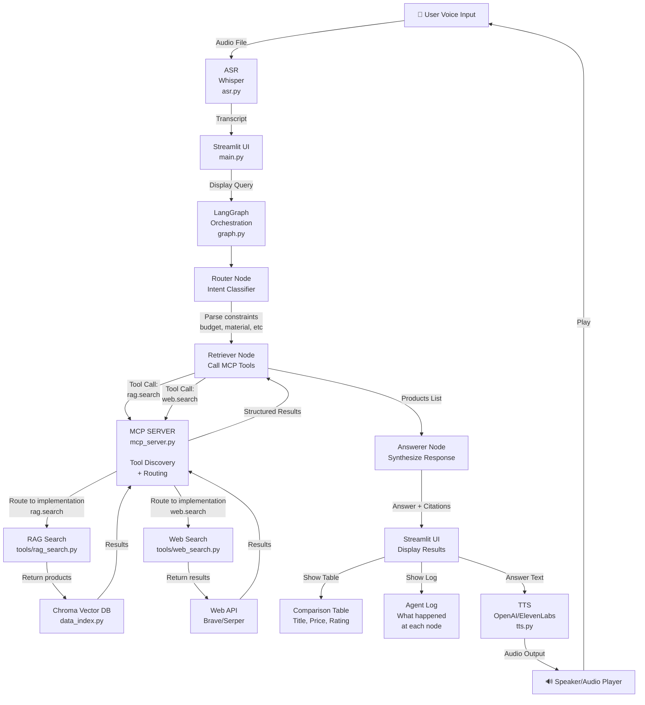

# Agentic Voice-to-Voice AI

A voice-to-voice, multi-agent shopping assistant for e-commerce. Users speak a natural-language product request (e.g. *"I need an eco-friendly stainless-steel cleaner under $15"*), and the system interprets intent, plans a retrieval strategy, grounds its answer in a private product catalog (with optional live web comparison), and replies by voice with cited sources.

Built for ADSP 32028 — Applied Generative AI: Agents and Multimodal Intelligence.

## Project Context

Traditional chatbots struggle to interpret spoken intent, search private catalogs, check live availability, and answer clearly — especially hands-free. This project delivers an assistant that:

- Enables voice-to-voice queries for intuitive product search & comparison
- Uses a multi-agent flow (intent → plan → retrieve/tools → summarize) orchestrated with **LangGraph**
- Provides context-aware, grounded recommendations with citations to both private data and any live sources retrieved

## Architecture

Orchestration is a LangGraph pipeline. Every retrieval path — private catalog or live web — is routed through a single MCP server exposing two tools, never called directly:



The [Architecture](Architecture/) folder also has [architecture_comparison.mermaid](Architecture/architecture_comparison.mermaid), which contrasts a naive direct-function-call design against the required MCP-routed design — useful context for why the pipeline is shaped this way.

## Key Components

| Component | Role |
|---|---|
| **Agentic Orchestration (LangGraph)** | Router (intent classifier) → Planner (source/field selection) → Retriever (agentic RAG via MCP) → Answerer/Critic (grounded synthesis + safety) |
| **ASR** | Speech-to-text via Whisper (or comparable); fragment-based (record → transcribe) or streaming |
| **Agentic RAG** | Hybrid vector + metadata search over a curated slice of the Amazon Product Dataset 2020 (e.g. Household Cleaning), indexed in FAISS/Chroma |
| **MCP Server** | One server, two tools — `rag.search` (private catalog) and `web.search` (live comparison via Brave/Serper/Bing) — with tool discovery, schemas, caching (TTL 60–300s), and logging |
| **TTS** | Spoken answer ≤15s, fragment-based or streaming (OpenAI TTS, ElevenLabs, Azure Speech, Amazon Polly, Coqui) |
| **UI** | Streamlit (or React): mic input, live transcript, agent step log, comparison table, citations, Play-TTS button |
| **LLM** | Model-agnostic — swappable via environment variables/config (OpenAI, Anthropic, Gemini, Bedrock, or open-weight Llama/Mistral/Qwen/Phi) |

## Data

Primary corpus: **Amazon Product Dataset 2020** (Kaggle).

- `products.parquet` — id, title, brand, category, price, rating, features, ingredients
- `reviews.parquet` (optional) — product_id, stars, summary/snippets

Products are embedded on title + features + selected review snippets and indexed for hybrid retrieval; prices are unit-normalized (e.g. price per oz) for fair comparison.

## Repository Structure

```
Project/
├── Architecture/          # System diagrams (Mermaid)
├── Code/                  # Implementation (in progress)
├── Project Overview/      # Project description, team structure & task breakdown
└── README.md
```

Planned code layout as implementation lands:

```
Code/
├── data/       # ingestion, preprocessing, vector DB indexing
├── graph/      # LangGraph nodes: router, planner, retriever, answerer
├── tools/      # MCP server + rag.search / web.search implementations
├── ui/         # Streamlit app
├── prompts/    # system/tool/router/planner prompts (prompt disclosure)
└── .env.example
```

## Team

See [team_structure_and_task_breakdown.md](Project%20Overview/team_structure_and_task_breakdown.md) for the full role breakdown, week-by-week critical path, and deliverables checklist.

| Role | Owns |
|---|---|
| Orchestration Lead | LangGraph pipeline, routing logic, prompts, conflict resolution |
| Data Engineer | Data pipeline, vector DB indexing, hybrid retrieval, RAG eval |
| Voice/Integration Engineer | ASR, TTS, MCP server, web-search tool, performance testing |
| Frontend/UI Engineer | Streamlit app, audio I/O, comparison table, UX |
| Project Lead | Coordination, docs, prompt disclosure, presentation |

## Milestones

| Checkpoint | Week | Deliverable |
|---|---|---|
| Checkpoint 1 | Week 6 | One-page proposal, data slice, ingestion notebook, related work |
| Checkpoint 2 | Week 8 | Architecture diagram (graph + MCP calls), UI wireframe, RAG eval plan, MCP README |
| Final | Week 10 | Live demo (≤7 min), clean repo, README, build scripts, presentation |

## Status

🚧 Early stage — architecture and team planning are in place; implementation has not started yet (`Code/` is currently empty).

## License

TBD.
