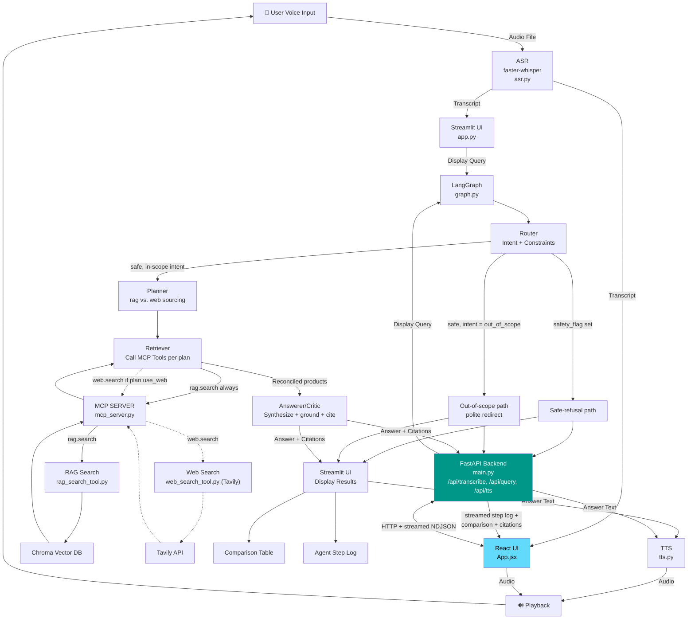

# Agentic Voice-to-Voice AI

A voice-to-voice, multi-agent shopping assistant: speak a product request, and the system interprets intent, retrieves from a private catalog (with optional live web comparison), and replies by voice with cited sources.

Built for ADSP 32028 — Applied Generative AI: Agents and Multimodal Intelligence.

## Getting Started

**Prerequisites:** Python 3.11+, an OpenAI API key (LLM + TTS), a Tavily API key (web search, free tier).

```bash
pip install -r requirements.txt
cp .env.example .env   # fill in OPENAI_API_KEY, TAVILY_API_KEY, LLM_MODEL
streamlit run "Code/5. User Interface/app.py"
```

Opens at `http://localhost:8501`. Mock-data mode is on by default ($0 cost) — toggle it off in the sidebar to run the real pipeline. The MCP server starts automatically; nothing else to run.

The vector index is already committed, so no rebuild is needed. To rebuild, run notebooks `1.1` → `1.2` → `1.3`.

**Alternative UI:** a React + FastAPI webapp (`webapp/`) is also available -- same pipeline, voice-first layout. See [webapp/README.md](webapp/README.md) to run it. Streamlit stays the reference UI; either one satisfies the project's UI deliverable.

## Architecture

One LangGraph pipeline; every retrieval path (private catalog or live web) goes through a single MCP server exposing two tools:



Two UI options, same pipeline underneath (`graph.py` doesn't know or care which one called it) -- Streamlit stays the reference UI, React+FastAPI is an alternative. Streamlit is one process calling `asr.py`/`graph.py`/`tts.py` in-process; React+FastAPI is two processes talking over HTTP, with `main.py` as a thin API layer over the exact same modules. See [webapp/README.md](webapp/README.md) for the React+FastAPI path.

See also [architecture_comparison.mermaid](Architecture/architecture_comparison.mermaid) (naive vs. MCP-routed design).

## Key Components

| Component | Role |
|---|---|
| **Orchestration (LangGraph)** | Router → Planner → Retriever → Answerer/Critic |
| **ASR** | Local `faster-whisper`, free, fragment-based |
| **Agentic RAG** | Hybrid vector + metadata search, Chroma (`products_home_kitchen` demo slice + `products_all` full catalog) |
| **MCP Server** | One server, two tools — `rag.search`, `web.search` (Tavily) — with caching + logging |
| **TTS** | OpenAI TTS, ≤15s answers, provider-swappable |
| **UI** | Streamlit (reference) — mic input, step log, comparison table, citations, Play-TTS. React + FastAPI (alternative) — voice-first orb, hands-free loop |
| **LLM** | Model-agnostic via env config (OpenAI, Anthropic, Gemini, Bedrock, open-weight) |

## Data

**[Amazon Product Dataset 2020](https://www.kaggle.com/datasets/promptcloud/amazon-product-dataset-2020)** (Kaggle, CC0). 10,002 products, 28 columns — but no rating/review/ingredients data, and `Brand Name`/`Asin`/`Sku` are 100% empty. Demo category: **`Home & Kitchen`** (706 rows, mostly kids' bedding/furniture/party supplies, not cookware).

Full schema, gaps, and licensing: [data_schema_and_licensing.md](Project%20Overview/data_schema_and_licensing.md).

## Repository Structure

```
Project/
├── Architecture/        # System diagrams (Mermaid) -- shared across Code/ sections
├── Code/                 # Implementation, numbered to match the task backlog
│   ├── 1. Data Pipeline & Indexing/     # exploration, cleaning, embedding, retrieval, eval
│   ├── 2. Agentic Orchestration/        # LangGraph nodes + graph.py
│   ├── 3. MCP Server & Tools/           # MCP server + rag.search/web.search
│   ├── 4. Speech (ASR + TTS)/           # asr.py, tts.py
│   ├── 5. User Interface/               # Streamlit app.py
│   └── 6. Prompts & Documentation/      # system prompts
├── Data/                 # Raw Kaggle download (see Data/README.md)
├── Project Overview/     # Team structure, task backlog, data schema, RAG eval plan
├── webapp/               # Alternative UI: React + FastAPI (see webapp/README.md)
├── requirements.txt
├── .env.example
└── README.md
```

Each numbered `Code/` folder has its own README or module docstrings for detail. Two things worth knowing: `speech_config.py` (§4) is deliberately not named `config.py` (§5's UI imports both in one process, and same-named modules would collide); `2.1-2.6 graph and nodes.ipynb` is a frozen design record, not kept in sync with the live `.py` files.

## Team

4-person team, no separate Project Lead — see [team_structure_and_task_breakdown.md](Project%20Overview/team_structure_and_task_breakdown.md) for roles and [detailed_task_backlog.md](Project%20Overview/detailed_task_backlog.md) for the task list.

| Role | Owns |
|---|---|
| Orchestration Lead | LangGraph pipeline, prompts, conflict resolution |
| Data Engineer | Data pipeline, indexing, hybrid retrieval, RAG eval |
| Voice/Integration Engineer | ASR, TTS, MCP server, web-search tool |
| Frontend/UI Engineer | Streamlit app, README, demo/presentation |

## Milestones

| Checkpoint | Week | Deliverable |
|---|---|---|
| Checkpoint 1 | 6 | Proposal, data slice, ingestion notebook |
| Checkpoint 2 | 8 | Architecture diagram, UI integration, RAG eval, MCP README |
| Final | 10 | Live demo (≤7 min), clean repo, presentation |

## Status

🚧 §1-5 (Data, Orchestration, MCP, Speech, UI) implemented and tested, including performance/reliability (see [performance_reliability_report.md](Project%20Overview/performance_reliability_report.md)). Remaining: usability testing with real external users (needs people outside the team).

## License

TBD.
