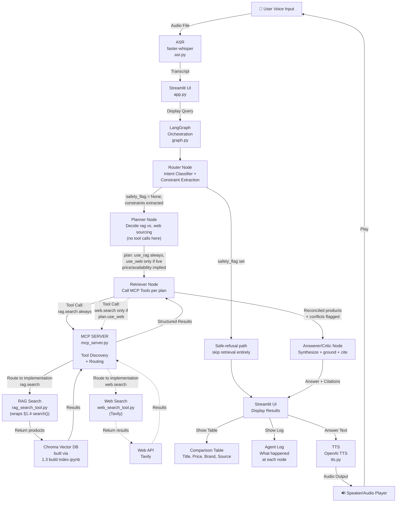

# Agentic Voice-to-Voice AI

A voice-to-voice, multi-agent shopping assistant for e-commerce. Users speak a natural-language product request (e.g. *"I need an insulated lunch box for my kid under $15"*), and the system interprets intent, plans a retrieval strategy, grounds its answer in a private product catalog (with optional live web comparison), and replies by voice with cited sources.

Built for ADSP 32028 — Applied Generative AI: Agents and Multimodal Intelligence.

## Project Context

Traditional chatbots struggle to interpret spoken intent, search private catalogs, check live availability, and answer clearly — especially hands-free. This project delivers an assistant that:

- Enables voice-to-voice queries for intuitive product search & comparison
- Uses a multi-agent flow (intent → plan → retrieve/tools → summarize) orchestrated with **LangGraph**
- Provides context-aware, grounded recommendations with citations to both private data and any live sources retrieved

## Architecture

Orchestration is a LangGraph pipeline. Every retrieval path — private catalog or live web — is routed through a single MCP server exposing two tools, never called directly:



See also [architecture_comparison.mermaid](Architecture/architecture_comparison.mermaid) — contrasts a naive direct-function-call design against the required MCP-routed design.

## Key Components

| Component | Role |
|---|---|
| **Agentic Orchestration (LangGraph)** | Router (intent classifier) → Planner (source/field selection) → Retriever (agentic RAG via MCP) → Answerer/Critic (grounded synthesis + safety) |
| **ASR** | Speech-to-text via local `faster-whisper` (free, no API key); fragment-based |
| **Agentic RAG** | Hybrid vector + metadata search over the Amazon Product Dataset 2020, indexed in Chroma as two collections: `products_home_kitchen` (706-row demo slice) and `products_all` (9,930 rows, full catalog) |
| **MCP Server** | One server, two tools — `rag.search` (private catalog) and `web.search` (live comparison via Tavily) — with tool discovery, schemas, caching, and logging |
| **TTS** | Spoken answer ≤15s via OpenAI TTS (provider-swappable by construction) |
| **UI** | Streamlit: mic input, live transcript, agent step log, comparison table, citations, Play-TTS button |
| **LLM** | Model-agnostic — swappable via environment variables/config (OpenAI, Anthropic, Gemini, Bedrock, or open-weight) |

## Data

Primary corpus: **[Amazon Product Dataset 2020](https://www.kaggle.com/datasets/promptcloud/amazon-product-dataset-2020)** (Kaggle, `promptcloud/amazon-product-dataset-2020`).

```python
import kagglehub
path = kagglehub.dataset_download("promptcloud/amazon-product-dataset-2020")
```

Resolves to one CSV — **10,002 products, 28 columns**. The real schema differs from a generic "id/title/brand/price/rating/features/ingredients" sketch:

| Field we need | Actual column | Note |
|---|---|---|
| id | `Uniq Id` | 100% populated, zero duplicates |
| title | `Product Name` | 100% populated, 137 duplicates — dedupe in preprocessing |
| category | `Category` | 91.7% populated, pipe-delimited hierarchy |
| price | `Selling Price` | 98.9% non-null, 95.2% parse cleanly; `List Price` is 0% populated |
| features | `About Product` | 97.3% populated; closest match, no column literally named "features" |
| brand | — | `Brand Name` is **100% empty** — parsed from `Product Name` instead |
| ingredients / rating / reviews | — | **None of these exist in this dataset** |
| join key for a 2nd dataset | — | `Asin`/`Sku` are also 100% empty — any join would have to be fuzzy, by title |

13 of the 28 columns are entirely empty — see [column_coverage.csv](Code/1.%20Data%20Pipeline%20&%20Indexing/processed/column_coverage.csv) for the full breakdown.

Category distribution is skewed (~67% Toys & Games); **`Home & Kitchen`** (706 rows) is the demo category, mostly kids' bedding/furniture/décor/party supplies rather than cookware. Practical implications:
- No rating/ingredients data exists — dropped from the pitch/UI rather than faked
- Brand is regex-parsed from the title, not a reliable field — treated as low-confidence
- Demo queries target what the data actually has (lunch boxes, bedding, storage, party supplies)

Full schema + licensing (CC0 Public Domain) write-up: [data_schema_and_licensing.md](Project%20Overview/data_schema_and_licensing.md).

## Repository Structure

Folders under `Code/` are numbered to match the [task backlog](Project%20Overview/detailed_task_backlog.md)'s section numbers.

```
Code/
├── 1. Data Pipeline & Indexing/
│   ├── 1.1 explore data.ipynb        # field coverage, price distribution, category counts
│   ├── 1.2 process data.ipynb        # text cleaning, brand/unit extraction, dedup
│   ├── 1.3 build index.ipynb         # embedding + Chroma indexing (2 collections)
│   ├── 1.4 hybrid retrieval.ipynb    # vector + metadata search, unit-aware tie-breaking
│   ├── 1.5 rag evaluation.ipynb      # precision/recall@5 eval set
│   └── processed/                    # products_clean.csv, chroma_db_home_kitchen/ (committed),
│                                      #   chroma_db_all/ (gitignored — rebuild via 1.3)
├── 2. Agentic Orchestration/
│   ├── 2.1-2.6 graph and nodes.ipynb # frozen design/prototyping record, not kept in sync
│   ├── 2.7 testing.ipynb             # tests the real graph.py — e2e + regression queries
│   ├── config.py, state.py, providers.py   # config, GraphState schema, LLM provider abstraction
│   ├── router.py, planner.py               # Router (+ safe_refusal) and Planner nodes
│   ├── retriever.py, mcp_client.py         # Retriever node + persistent MCP client
│   ├── answerer.py                         # Answerer/Critic node — grounding, citations, TTS-length budget
│   └── graph.py                            # compiles the graph; invoke via `await graph.ainvoke(...)`
├── 3. MCP Server & Tools/             # see the README inside for full detail
│   ├── mcp_server.py                  # stdio MCP server, registers both tools
│   ├── rag_search_tool.py             # rag.search — wraps §1.4/§2.4's search()
│   ├── web_search_tool.py             # web.search — Tavily, caching, backoff, domain allowlist
│   ├── tool_logging.py                # logging, secret scrubbing, typed ToolError
│   └── 3.1-3.4 *.ipynb                # real subprocess + stdio tests per tool
├── 4. Speech (ASR + TTS)/
│   ├── speech_config.py              # ASR/TTS config (separate from §2's config.py — see note below)
│   ├── asr.py                        # transcribe() — local faster-whisper, typed ASRError
│   ├── tts.py                        # synthesize() — OpenAI TTS, measured <=15s budget, typed TTSError
│   └── 4.1-4.2 speech smoke test.ipynb  # real TTS->ASR round trip + error paths
├── 5. User Interface/
│   ├── app.py                        # Streamlit entrypoint — mic/upload/text input, step log,
│   │                                  #   comparison table, citations, Play-TTS, mock-data mode
│   └── async_runtime.py              # sync<->async bridge so the persistent MCP session
│                                      #   survives across Streamlit reruns
└── 6. Prompts & Documentation/
    ├── router_system_prompt.md
    ├── planner_rules.md               # not an LLM prompt — Planner is rule-based, no LLM call
    └── answerer_critic_system_prompt.md
```

Two notes worth knowing before editing: `speech_config.py` (§4) is deliberately not named `config.py` — §5's UI imports both §2's and §4's config in one process, and two same-named bare modules would silently collide. `2.1-2.6 graph and nodes.ipynb` is an intentionally frozen design record; the `.py` files are the live implementation.

## Team

See [team_structure_and_task_breakdown.md](Project%20Overview/team_structure_and_task_breakdown.md) for the full role breakdown and [detailed_task_backlog.md](Project%20Overview/detailed_task_backlog.md) for the granular task list.

4-person team, no separate Project Lead — coordination/documentation duties are folded into the 4 roles:

| Role | Owns |
|---|---|
| Orchestration Lead | LangGraph pipeline, routing logic, prompts, conflict resolution, `prompts/` folder, graph design write-up, safety notes |
| Data Engineer | Data pipeline, vector DB indexing, hybrid retrieval, RAG eval, data write-up |
| Voice/Integration Engineer | ASR, TTS, MCP server, web-search tool, performance testing, MCP README |
| Frontend/UI Engineer | Streamlit app, audio I/O, comparison table, UX, root README, `.env.example`, demo/presentation |

## Milestones

| Checkpoint | Week | Deliverable |
|---|---|---|
| Checkpoint 1 | Week 6 | One-page proposal, data slice, ingestion notebook, related work |
| Checkpoint 2 | Week 8 | Architecture diagram (graph + MCP calls), UI wireframe, RAG eval plan, MCP README |
| Final | Week 10 | Live demo (≤7 min), clean repo, README, build scripts, presentation |

## Status

🚧 In progress — §1-4 (Data, Orchestration, MCP, Speech) are implemented and tested. §5 (UI) scaffold + core flow are wired end-to-end and tested; polish (§5.3) not started.

## License

TBD.
