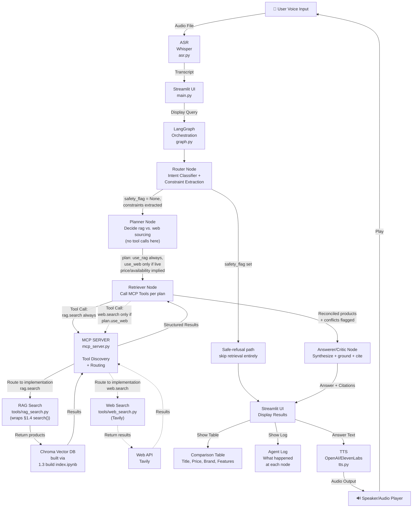

# Agentic Voice-to-Voice AI

A voice-to-voice, multi-agent shopping assistant for e-commerce. Users speak a natural-language product request (e.g. *"I need an insulated lunch box for my kid under $15"*), and the system interprets intent, plans a retrieval strategy, grounds its answer in a private product catalog (with optional live web comparison), and replies by voice with cited sources.

Built for ADSP 32028 — Applied Generative AI: Agents and Multimodal Intelligence.

## Project Context

Traditional chatbots struggle to interpret spoken intent, search private catalogs, check live availability, and answer clearly — especially hands-free. This project delivers an assistant that:

- Enables voice-to-voice queries for intuitive product search & comparison
- Uses a multi-agent flow (intent → plan → retrieve/tools → summarize) orchestrated with **LangGraph**
- Provides context-aware, grounded recommendations with citations to both private data and any live sources retrieved

## Architecture

Orchestration is a LangGraph pipeline. Every retrieval path — private catalog or live web — is routed through a single MCP server exposing two tools, never called directly:



The [Architecture](Architecture/) folder also has [architecture_comparison.mermaid](Architecture/architecture_comparison.mermaid), which contrasts a naive direct-function-call design against the required MCP-routed design — useful context for why the pipeline is shaped this way.

## Key Components

| Component | Role |
|---|---|
| **Agentic Orchestration (LangGraph)** | Router (intent classifier) → Planner (source/field selection) → Retriever (agentic RAG via MCP) → Answerer/Critic (grounded synthesis + safety) |
| **ASR** | Speech-to-text via Whisper (or comparable); fragment-based (record → transcribe) or streaming |
| **Agentic RAG** | Hybrid vector + metadata search over the Amazon Product Dataset 2020, indexed in Chroma as two collections: `products_home_kitchen` (706-row demo slice) and `products_all` (9,930 rows, full catalog) |
| **MCP Server** | One server, two tools — `rag.search` (private catalog) and `web.search` (live comparison via Tavily) — with tool discovery, schemas, caching (TTL 60–300s), and logging |
| **TTS** | Spoken answer ≤15s, fragment-based or streaming (OpenAI TTS, ElevenLabs, Azure Speech, Amazon Polly, Coqui) |
| **UI** | Streamlit (or React): mic input, live transcript, agent step log, comparison table, citations, Play-TTS button |
| **LLM** | Model-agnostic — swappable via environment variables/config (OpenAI, Anthropic, Gemini, Bedrock, or open-weight Llama/Mistral/Qwen/Phi) |

## Data

Primary corpus: **[Amazon Product Dataset 2020](https://www.kaggle.com/datasets/promptcloud/amazon-product-dataset-2020)** (Kaggle, `promptcloud/amazon-product-dataset-2020`).

```python
import kagglehub
path = kagglehub.dataset_download("promptcloud/amazon-product-dataset-2020")
```

This resolves to a single CSV, `marketing_sample_for_amazon_com-ecommerce__20200101_20200131__10k_data.csv` — **10,002 products, 28 columns**. We downloaded and inspected it directly (see [Code/1. Data Pipeline & Indexing/1.1 explore data.ipynb](Code/1.%20Data%20Pipeline%20&%20Indexing/1.1%20explore%20data.ipynb)); the real schema differs from a generic "id/title/brand/price/rating/features/ingredients" sketch in a few ways worth knowing before building on it. Everything here stays CSV end-to-end — no parquet conversion.

| Field we need | Actual column | Note |
|---|---|---|
| id | `Uniq Id` | ✅ 100% populated, zero duplicates — the real primary key |
| title | `Product Name` | ✅ 100% populated, but 137 duplicate values — dedupe in preprocessing |
| category | `Category` | 91.7% populated (pipe-delimited hierarchy, e.g. `Home & Kitchen \| ...`); ~8% of rows have no category |
| price | `Selling Price` | 98.9% non-null, but only 95.2% parse to a clean number; use this, not `List Price` (**0% populated**) |
| features | `About Product` | 97.3% populated; closest match to a feature-bullet field, no column literally named "features" |
| brand | — | `Brand Name` column exists but is **empty in 100% of rows** — must be parsed from `Product Name`/`About Product` instead |
| ingredients | — | `Ingredients` column exists but is **empty in 100% of rows** — treat as unavailable |
| rating | — | **no rating/stars field exists anywhere in this file** |
| reviews | — | **no review-level data** — this is a single flat product table, not a products+reviews pair |
| join key for a 2nd dataset | — | **`Asin` and `Sku` are also 100% empty** — no reliable external key exists; any join would have to be fuzzy, by title |

**13 of the 28 columns are entirely empty** (`Product Description, Stock, Size Quantity Variant, Product Details, Dimensions, Color, Quantity, Ingredients, Asin, Brand Name, Direction To Use, List Price, Sku`) — see [Code/1. Data Pipeline & Indexing/processed/column_coverage.csv](Code/1.%20Data%20Pipeline%20&%20Indexing/processed/column_coverage.csv) for the full per-column breakdown.

Category distribution is also skewed: **67% Toys & Games**; `Home & Kitchen` (706 rows) and `Sports & Outdoors` (540 rows) are the next largest, while `Household`/`Cleaning` categories total only ~25 rows — too sparse to be the demo slice. **`Home & Kitchen` is the demo category**, composed mainly of kids' bedding, furniture, décor, party supplies, and lunch boxes (only ~7.5% is Kitchen & Dining).

Practical implications:
- Star ratings can't be cited in answers/UI unless a second dataset is fuzzy-joined by title (no ASIN/SKU key exists here) — otherwise drop rating from the pitch and UI.
- Brand should be extracted via regex/LLM parsing from `Product Name`, not read from `Brand Name`.
- "Ingredients" won't be populated for any products; don't design retrieval filters that assume it is.
- Demo/example queries should target what this data actually has: kids' lunch boxes, bedding, furniture, storage, party supplies.

Full writeup of the schema decision and licensing (CC0 Public Domain): [Project Overview/data_schema_and_licensing.md](Project%20Overview/data_schema_and_licensing.md).

Products are embedded on `Product Name` + `About Product` (+ `Product Specification`/`Technical Details` if useful) and indexed for hybrid retrieval; prices are unit-normalized where package size is available, for fair comparison.

## Repository Structure

Folders under `Code/` are numbered to match the [task backlog](Project%20Overview/detailed_task_backlog.md)'s own section numbers, so it's always obvious which part of the backlog a given folder implements.

```
Project/
├── Architecture/                    # System diagrams (Mermaid)
├── Code/                            # Implementation (in progress)
│   ├── 1. Data Pipeline & Indexing/ # §1 — exploration/preprocessing/indexing notebooks
│   │                                 #   (CSV in, CSV out — no parquet)
│   └── 2. Agentic Orchestration/    # §2 — LangGraph state schema + node graph (design started)
├── Data/                            # Raw Kaggle download (CSV + zip) — see Data/README.md
├── Project Overview/                # Project description, team structure, task backlog, data schema & licensing
├── .env.example                     # config template (embeddings, LLM, web-search — see §1.3)
└── README.md
```

Code layout as implementation lands (folder numbers match backlog sections §1–§6; §3–§6 are
still planned, named here for orientation only):

```
Code/
├── 1. Data Pipeline & Indexing/
│   ├── 1.1 explore data.ipynb       # field coverage, price distribution, duplicates, category counts
│   ├── 1.2 process data.ipynb       # text cleaning, brand/unit extraction, dedup, category flattening
│   ├── 1.3 build index.ipynb        # embedding + Chroma indexing (2 collections), viz, config-driven
│   ├── 1.4 hybrid retrieval.ipynb   # vector + metadata search, unit-aware tie-breaking, doc_id citations
│   ├── 1.5 rag evaluation.ipynb     # precision/recall@5 eval set, failure-case analysis
│   └── processed/                   # generated outputs (column_coverage.csv, products_clean.csv,
│                                     #   chroma_db_home_kitchen/ [committed, ~6.6MB],
│                                     #   chroma_db_all/ [gitignored, ~65MB — rebuild via 1.3])
├── 2. Agentic Orchestration/
│   ├── 2.1-2.6 graph and nodes.ipynb # design/prototyping record (§2.1-2.6, frozen, not
│   │                                 #   re-synced with the .py files below)
│   ├── 2.7 testing.ipynb             # imports the real graph.py for real (§2.7) — extraction
│   │                                 #   sanity checks (free), 1 e2e test, 6-query regression set
│   ├── config.py                     # REPO_ROOT, .env loading (§2.6)
│   ├── state.py                      # GraphState/Plan/ToolResults, EMPTY_STATE (§2.1)
│   ├── providers.py                  # get_chat_model() real branching + invoke_and_log() (§2.6)
│   ├── router.py                     # Router + safe_refusal nodes (§2.2)
│   ├── planner.py                    # Planner node, rule-based (§2.3)
│   ├── retriever.py                  # Retriever node, search() ported from §1.4 (§2.4)
│   ├── answerer.py                   # Answerer/Critic node (§2.5)
│   └── graph.py                      # wires the above into the compiled `graph` — this is
│                                     #   what §2.7 imports today, §5's UI will import later
├── 3. MCP Server & Tools/           # (planned) MCP server + rag.search / web.search implementations
├── 4. Speech (ASR + TTS)/           # (planned) Whisper (or comparable) + TTS provider
├── 5. User Interface/               # (planned) Streamlit app
└── 6. Prompts & Documentation/
    ├── router_system_prompt.md          # Router's system prompt (§6 Prompt Disclosure)
    ├── planner_rules.md                 # Planner's rule + rationale (not an LLM prompt — §2.3
    │                                     #   explains why)
    └── answerer_critic_system_prompt.md # Answerer/Critic's system prompt. Retriever (§2.4)
                                          #   has no prompt of its own — no LLM call in that node
```

## Team

See [team_structure_and_task_breakdown.md](Project%20Overview/team_structure_and_task_breakdown.md) for the full role breakdown, week-by-week critical path, and deliverables checklist.

For the granular, checkable engineering task list (per component, per checkpoint), see [detailed_task_backlog.md](Project%20Overview/detailed_task_backlog.md).

| Role | Owns |
|---|---|
| Orchestration Lead | LangGraph pipeline, routing logic, prompts, conflict resolution |
| Data Engineer | Data pipeline, vector DB indexing, hybrid retrieval, RAG eval |
| Voice/Integration Engineer | ASR, TTS, MCP server, web-search tool, performance testing |
| Frontend/UI Engineer | Streamlit app, audio I/O, comparison table, UX |
| Project Lead | Coordination, docs, prompt disclosure, presentation |

## Milestones

| Checkpoint | Week | Deliverable |
|---|---|---|
| Checkpoint 1 | Week 6 | One-page proposal, data slice, ingestion notebook, related work |
| Checkpoint 2 | Week 8 | Architecture diagram (graph + MCP calls), UI wireframe, RAG eval plan, MCP README |
| Final | Week 10 | Live demo (≤7 min), clean repo, README, build scripts, presentation |

## Status

🚧 Early stage — architecture and team planning are in place; implementation has not started yet (`Code/` is currently empty).

## License

TBD.
